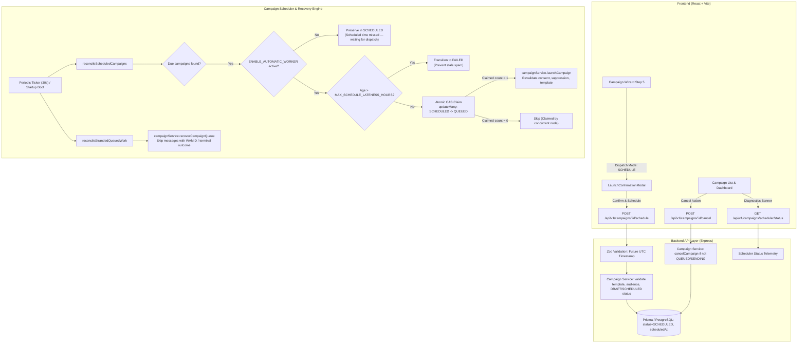

# Grovastra WhatsApp Campaign Scheduling & Durable Restart Recovery

## Executive Summary

Phase 10 implements **scheduled WhatsApp campaign dispatch** and **durable restart recovery** for Grovastra. The solution allows business users to compose WhatsApp campaigns, choose between immediate broadcast ("Send now") and automated future dispatch ("Schedule for later") with default business timezone **Asia/Kolkata (`IST (UTC+05:30)`)**, review all scheduling consequences before confirming, and rely on an atomic, crash-resilient backend reconciliation engine that guarantees **zero duplicate messages** across server reboots, overlapping scheduler ticks, or network interruptions.

All constraints were strictly honored:
- **Zero Database Migrations**: Reused existing Prisma schema columns (`status`, `scheduledAt`, `startedAt`, `completedAt`).
- **Zero Real WhatsApp Messages Sent**: All testing performed with isolated in-memory stores, strict validation mocks, and sandboxed test suites.
- **Strict Worker Safety Kill Switch**: `ENABLE_AUTOMATIC_WORKER=false` remains default dormant; due campaigns wait safely without sending until explicitly enabled by an operator.
- **Customer-Friendly Presentation**: Customer-facing UI exposes clean statuses (`Scheduled`, `Scheduled time missed — waiting for dispatch`, `Preparing messages`, `Sending`, `Completed`, `Completed with issues`, `Failed`, `Cancelled`) without developer stack traces or internal IDs.

---

## 1. Architectural Architecture & Subsystems



---

## 2. Key Components & Implementation Details

### A. Business Timezone Management (`Asia/Kolkata` Standard)
- **Backend**: `backend/src/utils/timezone.ts`
  - `DEFAULT_BUSINESS_TIMEZONE = "Asia/Kolkata"`
  - `parseScheduleToUTC(dateStr, timeStr)`: Combines local date and time in `+05:30` offset into an exact UTC `Date`.
  - `formatInBusinessTimezone(date)`: Formats dates into readable IST strings with AM/PM (e.g. `25 Oct 2026, 10:00 am IST`).
  - `isValidFutureSchedule(date, minLeadSeconds)`: Ensures schedule timestamps are strictly in the future.
- **Frontend**: `frontend/src/utils/timezone.ts`
  - `DEFAULT_BUSINESS_TIMEZONE = "Asia/Kolkata"`
  - `BUSINESS_TIMEZONE_LABEL = "IST (UTC+05:30)"`
  - `getDefaultScheduleInputs()`: Intelligently suggests upcoming business hours in IST (or tomorrow 10:00 AM if late evening).

### B. Campaign Wizard Scheduling Flow
- **Wizard Step 5 (Review & Launch)**: `frontend/src/components/CampaignWizard.tsx`
  - Radio toggle for **"Send now"** (queue broadcast immediately) vs **"Schedule for later"** (automated future dispatch).
  - Selecting "Schedule for later" reveals Date and Time pickers defaulting to IST (`Asia/Kolkata`), with past-date rejection.
  - Primary button toggles dynamically between `Review & Launch` (Send icon) and `Review & Schedule` (Clock icon).
  - Draft saving maintains `scheduledAt` when scheduled.

### C. Schedule Confirmation Modal
- **Confirmation Modal**: `frontend/src/components/LaunchConfirmationModal.tsx`
  - Header displays "Confirm Scheduled Campaign" with Clock icon.
  - Highlights scheduled dispatch time in IST (`Asia/Kolkata`).
  - Explicit warning box explaining that **messages will NOT be sent right now** and can be edited or cancelled anytime prior to dispatch.
  - Action button: `Confirm & Schedule Campaign`.

### D. Campaign List & Operational Status
- **Status Presentation**: `frontend/src/utils/campaignStatus.ts`
  - `SCHEDULED` in future -> `Scheduled` badge with helper text `Scheduled for [date, time] IST`.
  - `SCHEDULED` in past (worker dormant) -> `Scheduled time missed — waiting for dispatch` amber warning badge.
  - Clean mapping for all lifecycle states (`Preparing messages`, `Sending`, `Completed`, `Completed with issues`, `Failed`, `Cancelled`).
- **Campaign List Actions**: `frontend/src/components/CampaignList.tsx`
  - Allows editing `SCHEDULED` campaigns before dispatch starts.
  - Provides a red `Cancel` button for `SCHEDULED` campaigns that opens a confirmation modal before triggering cancellation.
- **Operational Banner**: `frontend/src/pages/CampaignsPage.tsx`
  - Displays worker operational state: `Dormant (Worker Inactive — Safety Mode)` when offline, informing operators that due campaigns wait safely.

### E. Backend Scheduler Engine & Safety Guarantees
- **Service**: `backend/src/services/campaignScheduler.service.ts`
  1. **Atomic CAS Locking**:
     ```ts
     const claimed = await prisma.campaign.updateMany({
       where: { id: campaign.id, status: CampaignStatus.SCHEDULED },
       data: { status: CampaignStatus.QUEUED },
     });
     if (claimed.count === 0) continue; // Claimed by concurrent process
     ```
  2. **Worker Dormant Protection**:
     - When `isWorkerRunning() === false` or `ENABLE_AUTOMATIC_WORKER === false`, due campaigns are left safely in `SCHEDULED` status without enqueueing messages.
  3. **Configurable Maximum Lateness Policy**:
     - `MAX_SCHEDULE_LATENESS_HOURS` (default: 24h, configured in `backend/src/config/env.ts`).
     - Stale campaigns older than 24 hours are expired directly to `FAILED` with reasons logged, rather than spamming users days later after an outage.
  4. **Stranded Queue Recovery**:
     - Reconciles interrupted `QUEUED` or `SENDING` messages without re-queueing any message with an existing WAMID or terminal state (`SENT`, `DELIVERED`, `READ`).
  5. **Startup & Shutdown Hooks**:
     - Hooked into `backend/src/server.ts`: initializes background loop on `app.listen()` and clears ticker during `gracefulShutdown()`.

---

## 3. Test Suites & Verification Results

### Frontend Test Suites (76 Passed / 9 Files)
```
 ✓ src/tests/csvConsentImportWizard.test.tsx (2 tests)
 ✓ src/tests/masterAdminAuth.test.tsx (6 tests)
 ✓ src/tests/customerCleanUI.test.tsx (8 tests)
 ✓ src/tests/masterAdminDashboard.test.tsx (5 tests)
 ✓ src/tests/whatsappSettings.test.tsx (12 tests)
 ✓ src/tests/campaignSchedulingUI.test.tsx (13 tests)
 ✓ src/tests/dashboardIntegration.test.tsx (7 tests)
 ✓ src/tests/campaignLaunchUI.test.tsx (14 tests)
 ✓ src/tests/campaignWizard.test.tsx (9 tests)

Test Files: 9 passed (9)
Tests:      76 passed (76)
Duration:   6.61s
Lint:       0 errors, 0 warnings
Build:      Production Vite bundle built cleanly (0 errors)
```

### Backend Test Suites (397 Passed / 29 Files)
```
 ✓ src/tests/campaignScheduler.test.ts (22 tests)
 ✓ src/tests/campaign.test.ts (28 tests)
 ✓ src/tests/campaignLaunch.test.ts (19 tests)
 ✓ src/tests/auth.test.ts (19 tests)
 ✓ src/tests/platformAuth.test.ts (19 tests)
 ✓ src/tests/templateWebhook.test.ts (15 tests)
 ... [23 additional test suites passed]

Test Files: 29 passed (29)
Tests:      397 passed (397)
Duration:   27.18s
Build:      TypeScript compiler built cleanly (0 errors)
```

---

## 4. Operator Walkthrough & Local Verification Guide

To verify campaign scheduling locally:

1. **Verify Backend Compilation & Tests**:
   ```powershell
   cd c:\Users\BALAJI\Desktop\growViews\grovastra\backend
   npm test -- src/tests/campaignScheduler.test.ts
   npm run build
   ```

2. **Verify Frontend Compilation & Tests**:
   ```powershell
   cd c:\Users\BALAJI\Desktop\growViews\grovastra\frontend
   npm test -- src/tests/campaignSchedulingUI.test.tsx
   npm run build
   npm run lint
   ```

3. **Check Operational Scheduler Telemetry**:
   ```http
   GET /api/v1/campaigns/scheduler/status
   ```
   **Response Body**:
   ```json
   {
     "success": true,
     "data": {
       "schedulerActive": true,
       "automaticDispatchEnabled": false,
       "workerRunning": false,
       "redisConfigured": false,
       "dueScheduledCount": 0,
       "overdueMissedCount": 0,
       "businessTimezone": "Asia/Kolkata",
       "maxLatenessHours": 24,
       "timestamp": "2026-10-17T11:00:00.000Z"
     }
   }
   ```

4. **Interactive Dashboard Verification**:
   - Navigate to **Campaigns** in the sidebar.
   - Observe the top banner displaying `Automatic Dispatch: Dormant (Worker Inactive — Safety Mode)` and `Due campaigns wait safely until dispatch worker is enabled.`
   - Click **Create Campaign**, complete steps 1–4, and on Step 5 select **Schedule for later**.
   - Review the default date and time in `Asia/Kolkata (IST (UTC+05:30))`.
   - Click **Review & Schedule** to view the confirmation modal with consequence checklist.
   - Click **Confirm & Schedule Campaign**.
   - Verify the campaign appears in the list with status `Scheduled for [date, time] IST`.
   - Click the red **Cancel Campaign** button and confirm cancellation to transition status to `Cancelled`.
